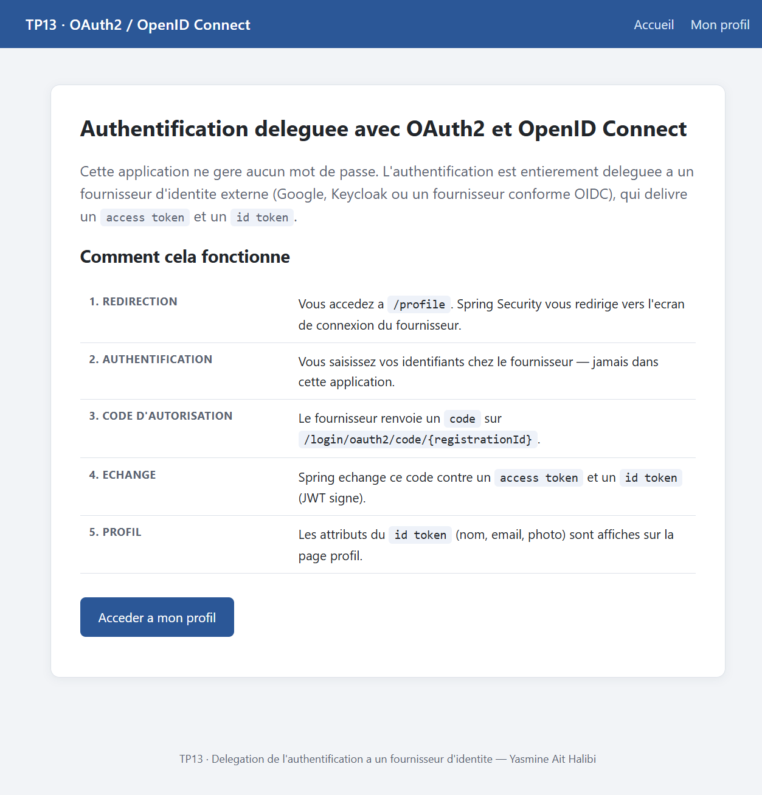
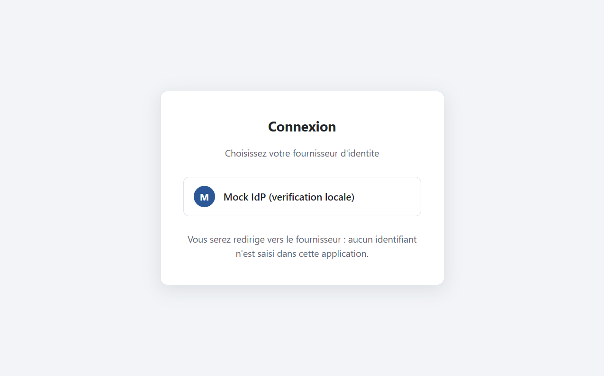
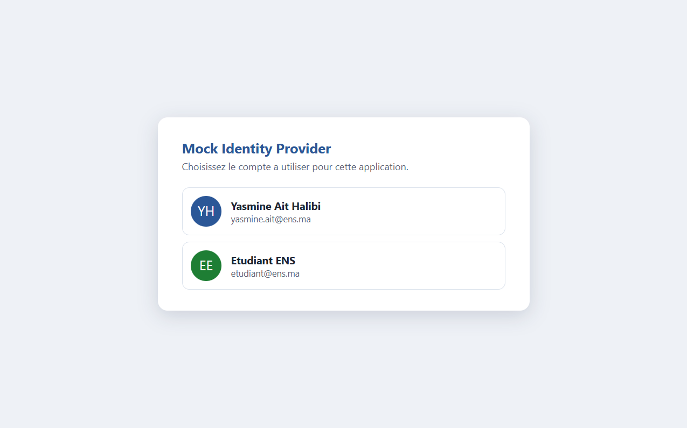
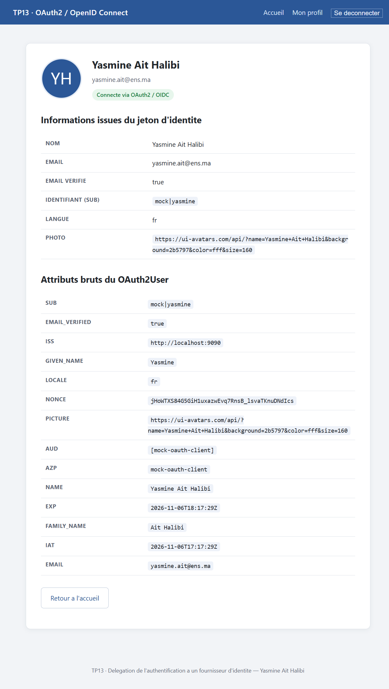
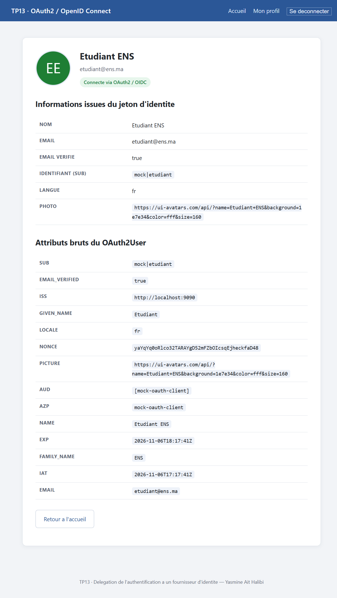

# TP13 — Authentification déléguée avec OAuth2 et OpenID Connect


> **Module** : Développement JakartaEE : Spring — **Cours 17**, TP n°13
> **Thème** : déléguer l'authentification à un fournisseur d'identité externe (Google, Keycloak, OIDC)
> **Auteure** : Yasmine Ait Halibi

---

## Table des matières

1. [Objectifs pédagogiques](#1-objectifs-pédagogiques)
2. [Le problème : pourquoi déléguer l'authentification ?](#2-le-problème--pourquoi-déléguer-lauthentification-)
3. [OAuth2 vs OpenID Connect](#3-oauth2-vs-openid-connect)
4. [Les quatre acteurs et les six étapes du flux](#4-les-quatre-acteurs-et-les-six-étapes-du-flux)
5. [Architecture de l'application](#5-architecture-de-lapplication)
6. [Structure du projet](#6-structure-du-projet)
7. [Les trois profils de configuration](#7-les-trois-profils-de-configuration)
8. [Configuration Spring Security : `SecurityConfig`](#8-configuration-spring-security--securityconfig)
9. [Le contrôleur : `HomeController`](#9-le-contrôleur--homecontroller)
10. [Les vues Thymeleaf](#10-les-vues-thymeleaf)
11. [Le fournisseur OIDC de vérification locale](#11-le-fournisseur-oidc-de-vérification-locale)
12. [Scénarios de test vérifiés](#12-scénarios-de-test-vérifiés)
13. [Tests automatisés](#13-tests-automatisés)
14. [Variante Keycloak](#14-variante-keycloak)
15. [Lancer le projet](#15-lancer-le-projet)
16. [Points pédagogiques essentiels](#16-points-pédagogiques-essentiels)
17. [Bonnes pratiques et limites](#17-bonnes-pratiques-et-limites)
18. [Conclusion](#18-conclusion)

---

## 1. Objectifs pédagogiques

À l'issue de ce TP, l'étudiant sait :

- expliquer les **principes et les acteurs** du protocole OAuth2 ;
- distinguer **OAuth2** (autorisation, *access token*) d'**OpenID Connect** (authentification, *id token*) ;
- configurer une application Spring Boot en **client OAuth2** (`spring-boot-starter-oauth2-client`) ;
- mettre en place une authentification avec **Google** ou **Keycloak** sans écrire une seule ligne de formulaire de login ;
- décrire le flux `authorization_code` : redirection, `state`, `code`, échange *back-channel*, `id_token`, session ;
- extraire et afficher les informations du profil utilisateur à partir du **token d'identité** (`OAuth2User`) ;
- comprendre le rôle des **scopes** (`openid`, `profile`, `email`) et de l'`issuer-uri` ;
- vérifier le comportement réel d'une application OAuth2 avec `curl` et une session de navigateur.

---

## 2. Le problème : pourquoi déléguer l'authentification ?

Dans les TP9 à TP12, l'application **gérait elle-même** les identifiants : elle stockait des mots de passe hachés, proposait un formulaire, validait un `UserDetails`. Cette approche a trois défauts structurels :

| Problème | Conséquence |
|---|---|
| L'application voit le mot de passe en clair à chaque login | La surface d'attaque inclut le formulaire, le transport, les logs |
| Chaque application redéveloppe MFA, réinitialisation, verrouillage de compte | Duplication, incohérence, bugs de sécurité |
| Aucun SSO entre applications | L'utilisateur multiplie les comptes et les mots de passe |

**Déléguer** l'authentification consiste à confier la vérification de l'identité à un **fournisseur d'identité** (IdP) de confiance. L'application ne reçoit plus jamais de mot de passe : elle reçoit un **jeton signé** attestant de l'identité de l'utilisateur. C'est le modèle utilisé par « Se connecter avec Google », « Se connecter avec GitHub », ou un Keycloak d'entreprise.

```
AVANT (TP9-TP12)                     APRES (TP13)
┌──────────────┐                     ┌──────────────┐        ┌──────────────┐
│ Application  │                     │ Application  │        │ Fournisseur  │
│              │                     │              │        │ d'identité   │
│ users table  │                     │  aucune      │  code  │              │
│ password hash│                     │  donnée      │◄──────►│  users       │
│ login form   │                     │  sensible    │ jeton  │  mots de passe│
└──────────────┘                     └──────────────┘        └──────────────┘
```

---

## 3. OAuth2 vs OpenID Connect

Les deux termes sont souvent confondus. Ils répondent à deux questions différentes :

| Protocole | Question à laquelle il répond | Jeton principal | Format |
|---|---|---|---|
| **OAuth2** | « L'application X est-elle autorisée à accéder à la ressource Y ? » | *Access token* | opaque ou JWT |
| **OpenID Connect (OIDC)** | « Qui est l'utilisateur Z ? » | *ID token* | **JWT signé** obligatoire |

**OAuth2** est un protocole d'**autorisation** (délégation d'accès). Il ne dit rien sur l'identité : un *access token* prouve un droit d'accès, pas une identité.

**OpenID Connect** est une **couche d'identité** posée au-dessus d'OAuth2. Il ajoute :

- le scope `openid` (obligatoire pour activer OIDC) ;
- un **ID token** : un JWT signé par l'IdP, contenant les *claims* d'identité (`sub`, `name`, `email`, `picture`, `iss`, `aud`, `exp`) ;
- un endpoint de découverte `/.well-known/openid-configuration` ;
- un endpoint `/userinfo` pour les claims complémentaires.

Dans Spring Security, `oauth2Login()` implémente les deux : il récupère l'*access token* **et** l'*ID token*, puis expose les claims via `OAuth2User`.

### Anatomie de l'ID token

Un ID token est un JWT en trois parties séparées par des points :

```
eyJhbGciOiJSUzI1NiIsImtpZCI6Im1vY2sta2V5LTEifQ . eyJzdWIiOiJtb2NrfHlh... . MEUCIQ...
└──────────── header ────────────┘   └────── payload ──────┘   └─ signature ─┘
      alg: RS256, kid                  les claims d'identité        RSA-SHA256
```

| Claim | Signification | Utilisé dans ce TP |
|---|---|---|
| `iss` | Émetteur du jeton | affiché pour prouver l'origine |
| `aud` | Destinataire (le `client-id`) | vérifié par Spring |
| `sub` | Identifiant stable de l'utilisateur chez l'IdP | affiché (`mock\|yasmine`) |
| `name` | Nom complet | affiché + avatar |
| `email` / `email_verified` | Adresse et statut de vérification | affichés |
| `picture` | URL de l'avatar | affiché |
| `exp` / `iat` | Expiration / émission | vérifiés par Spring |

> La signature `RS256` garantit que **seul l'IdP** a pu produire ce jeton : l'application la vérifie avec la clé publique récupérée sur le `jwks_uri`. C'est ce qui rend l'ID token fiable sans aucun échange préalable de secret.

---

## 4. Les quatre acteurs et les six étapes du flux

Le TP utilise le flux **`authorization_code`**, le seul recommandé pour une application web avec serveur.

| Acteur | Rôle | Ici |
|---|---|---|
| **Resource Owner** | L'utilisateur final | vous |
| **Client** | L'application qui veut identifier l'utilisateur | `oauth2-client` (port 8080) |
| **Authorization Server** | Délivre les jetons après authentification | Google / Keycloak / mock IdP |
| **Resource Server** | Expose les données de l'utilisateur (`/userinfo`) | le même IdP |

### Déroulement

```
  Navigateur                Application               Fournisseur d'identité
       │                         │                              │
  1    │── GET /profile ────────►│                              │
       │◄── 302 /login ──────────│  (non authentifié)           │
       │                         │                              │
  2    │── GET /oauth2/authorization/mock ───────────────────►  │
       │◄── 302 /authorize?response_type=code&client_id=… ──────│
       │        &scope=openid profile email&state=…&nonce=…     │
       │                         │                              │
  3    │── GET /authorize?… ─────────────────────────────────►  │
       │◄── page de login du fournisseur ──────────────────────  │
       │                         │       (identifiants saisis ICI, jamais dans l'app)
       │── POST credentials ──────────────────────────────────► │
  4    │◄── 302 /login/oauth2/code/mock?code=…&state=… ────────  │
       │                         │                              │
  5    │── GET /login/oauth2/code/mock?code=… ──►│              │
       │                         │── POST /token (code+secret) ►│   canal direct
       │                         │◄── access_token + id_token ──│   (back-channel)
       │                         │    (ID token signé RS256)    │
       │◄── 302 /profile ────────│                              │
       │    Set-Cookie: JSESSIONID=…                            │
       │                         │                              │
  6    │── GET /profile ────────►│                              │
       │◄── 200 profil (nom, email, sub, claims) ──             │
```

Les points cruciaux, invisibles depuis le navigateur :

- **Étape 2** : le paramètre `state` est un aléa stocké en session ; il protège du **CSRF** sur le callback. Le `nonce` protège de la **rejouabilité** de l'ID token.
- **Étape 5** : l'échange `code → tokens` se fait **serveur à serveur** avec le `client-secret`. Le navigateur ne voit jamais le secret ni l'*access token*.
- Le `code` est **à usage unique** et de courte durée.
- À l'étape 6, l'application crée une `HttpSession` : OAuth2 authentifie, mais la session applicative reste le mécanisme de maintien de l'état (contrairement à TP12 qui était *stateless*).

---

## 5. Architecture de l'application

```
                    ┌──────────────────────────────────────────┐
                    │  Application Spring Boot — port 8080     │
                    │                                          │
   Navigateur ─────►│  SecurityFilterChain                     │
                    │   ├─ /  /login  /css/**      → public    │
                    │   └─ /**                     → protégé   │
                    │                                          │
                    │  oauth2Login()                           │
                    │   ├─ loginPage("/login")                 │
                    │   ├─ defaultSuccessUrl("/profile", true) │
                    │   └─ OAuth2LoginAuthenticationFilter     │
                    │        ↕ (back-channel)                  │
                    │  ClientRegistrationRepository            │
                    └───────────────┬──────────────────────────┘
                                    │ HTTPS
                    ┌───────────────▼──────────────────────────┐
                    │  Fournisseur OIDC                        │
                    │  /.well-known/openid-configuration       │
                    │  /jwks      /authorize                   │
                    │  /token     /userinfo                    │
                    └──────────────────────────────────────────┘
```

Aucune table d'utilisateurs, aucun `PasswordEncoder`, aucune page de login locale : le formulaire de mot de passe appartient au fournisseur.

---

## 6. Structure du projet

```
tp13-spring-oauth2/
├── pom.xml
├── README.md
├── docs/
│   ├── build.log                    # sortie complète de mvn clean package
│   ├── tests.log                    # sortie complète de mvn test (17 tests)
│   ├── oauth2-verification.txt      # transcription des 13 scénarios vérifiés
│   ├── verify.ps1                   # script de vérification end-to-end
│   └── images/                      # 6 captures d'écran
├── tools/
│   ├── mock-idp/
│   │   └── server.js                # fournisseur OIDC minimal (vérification locale)
│   └── keycloak/
│       ├── docker-compose.yml       # Keycloak 26 sur le port 8180
│       └── ens-realm.json           # realm « ens-realm » + client + 2 utilisateurs
└── src/
    ├── main/
    │   ├── java/ma/ens/security/
    │   │   ├── OAuth2ClientApplication.java
    │   │   ├── config/
    │   │   │   └── SecurityConfig.java
    │   │   └── web/
    │   │       └── HomeController.java
    │   └── resources/
    │       ├── application.yml            # profil actif + port
    │       ├── application-google.yml     # fournisseur Google (défaut)
    │       ├── application-keycloak.yml   # fournisseur Keycloak
    │       ├── application-mock.yml       # fournisseur de vérification locale
    │       ├── static/css/style.css
    │       └── templates/
    │           ├── fragments.html         # en-tête et pied communs
    │           ├── index.html             # page publique
    │           ├── login.html             # liste des fournisseurs
    │           └── profile.html           # profil + attributs bruts
    └── test/
        ├── java/ma/ens/security/
        │   ├── SecurityConfigTest.java        # 6 tests
        │   ├── ProfileControllerTest.java     # 5 tests
        │   └── OAuth2ConfigurationTest.java   # 6 tests
        └── resources/application-test.yml     # profil « test » hors ligne
```

Dépendances (`pom.xml`) — exactement celles demandées à l'étape 1 du TP :

| Dépendance | Rôle |
|---|---|
| `spring-boot-starter-web` | contrôleurs et rendu HTTP |
| `spring-boot-starter-security` | `SecurityFilterChain`, session, CSRF |
| `spring-boot-starter-oauth2-client` | flux `authorization_code`, `OAuth2User`, découverte OIDC |
| `spring-boot-starter-thymeleaf` | vues serveur |
| `thymeleaf-extras-springsecurity6` | helpers `sec:` dans les templates |
| `lombok` | réduction du code de plomberie |

---

## 7. Les trois profils de configuration

Le TP demande Google (étape 2), puis propose Keycloak en variante (étape 6). Le projet livre **trois profils** sélectionnables par la variable d'environnement `APP_PROFILE`.

### `application.yml` — socle commun

```yaml
server:
  port: 8080

spring:
  application:
    name: oauth2-client
  profiles:
    active: ${APP_PROFILE:google}
  thymeleaf:
    cache: false
```

Le profil **Google** est actif par défaut, conformément au TP. `APP_PROFILE` permet de basculer sans toucher au code.

### `application-google.yml` — étape 2 du TP

```yaml
spring:
  security:
    oauth2:
      client:
        registration:
          google:
            client-id: ${GOOGLE_CLIENT_ID:1234567890-abcde.apps.googleusercontent.com}
            client-secret: ${GOOGLE_CLIENT_SECRET:GOCSPX-XYZ_SecretKey}
            scope:
              - openid
              - profile
              - email
        provider:
          google:
            issuer-uri: https://accounts.google.com
```

| Élément | Explication |
|---|---|
| `registration` | déclare le client OAuth2 : identifiant, secret, scopes demandés |
| `provider.issuer-uri` | URL d'émission ; Spring télécharge `/.well-known/openid-configuration` au démarrage pour découvrir les endpoints |
| `scope: openid` | active OpenID Connect (sans lui, pas d'ID token) |
| `scope: profile` / `email` | demandent le nom, l'avatar et l'adresse |

> **Le secret n'est jamais commité.** Il est lu dans une variable d'environnement ; la valeur par défaut n'est que le placeholder du TP (`GOCSPX-XYZ_SecretKey`), volontairement invalide pour qu'aucune vraie authentification ne puisse être tentée avec le dépôt tel quel.
>
> Pour un usage réel : console Google Cloud → activer « Google Identity » → créer des identifiants OAuth 2.0 → renseigner l'URI de redirection `http://localhost:8080/login/oauth2/code/google` → exporter `GOOGLE_CLIENT_ID` et `GOOGLE_CLIENT_SECRET`.

### `application-keycloak.yml` — étape 6 du TP

```yaml
spring:
  security:
    oauth2:
      client:
        registration:
          keycloak:
            client-id: ${KEYCLOAK_CLIENT_ID:spring-oauth-client}
            client-secret: ${KEYCLOAK_CLIENT_SECRET:5fae9b43-0000-0000-0000-000000000000}
            authorization-grant-type: authorization_code
            redirect-uri: "{baseUrl}/login/oauth2/code/keycloak"
            scope:
              - openid
              - profile
              - email
        provider:
          keycloak:
            issuer-uri: ${KEYCLOAK_ISSUER:http://localhost:8180/realms/ens-realm}
```

Différences avec Google :

- `authorization-grant-type` doit être explicite : Keycloak n'est pas un fournisseur pré-enregistré dans Spring, donc aucune valeur par défaut ne s'applique ;
- `redirect-uri` utilise le placeholder `{registrationId}` pour pointer sur `/login/oauth2/code/keycloak` ;
- l'`issuer-uri` contient le **realm** : `http://localhost:8180/realms/ens-realm`.

### `application-mock.yml` — profil de démonstration

```yaml
spring:
  security:
    oauth2:
      client:
        registration:
          mock:
            client-id: mock-oauth-client
            client-secret: mock-secret
            authorization-grant-type: authorization_code
            redirect-uri: "{baseUrl}/login/oauth2/code/{registrationId}"
            client-name: Mock IdP (verification locale)
            scope: [openid, profile, email]
        provider:
          mock:
            issuer-uri: http://localhost:9090
```

Ce profil pointe vers le petit fournisseur OIDC fourni dans `tools/mock-idp/` (voir §11). Il existe pour une raison précise : **il permet de démontrer et de vérifier le flux complet de bout en bout**, sans identifiants Google réels et sans démon Docker pour Keycloak. La configuration Spring Security est identique dans les trois cas — seule l'URL de l'émetteur change, ce qui est précisément la propriété intéressante d'OIDC.

### `application-test.yml` — profil des tests automatisés

```yaml
spring:
  security:
    oauth2:
      client:
        registration:
          test:
            client-id: test-client
            client-secret: test-secret
            authorization-grant-type: authorization_code
            redirect-uri: "{baseUrl}/login/oauth2/code/test"
            scope: [openid, profile, email]
        provider:
          test:
            authorization-uri: http://localhost:9999/oauth2/authorize
            token-uri: http://localhost:9999/oauth2/token
            user-info-uri: http://localhost:9999/oauth2/userinfo
            user-name-attribute: sub
```

> **Point technique important.** Un bloc `provider` contenant `issuer-uri` déclenche une **requête de découverte OIDC au démarrage du contexte Spring**. En test, cette requête échouerait (pas de réseau, pas d'IdP) et toute la suite tomberait. La solution consiste à **remplacer `issuer-uri` par les trois URLs explicites** (`authorization-uri`, `token-uri`, `user-info-uri`) pointant vers une adresse locale non sollicitée. Les tests démarrent ainsi hors ligne, en quelques millisecondes.

---

## 8. Configuration Spring Security : `SecurityConfig`

```java
@Configuration
public class SecurityConfig {

    @Bean
    public SecurityFilterChain securityFilterChain(HttpSecurity http) throws Exception {
        http
            .authorizeHttpRequests(auth -> auth
                .requestMatchers("/", "/login**", "/css/**", "/error").permitAll()
                .anyRequest().authenticated()
            )
            .oauth2Login(oauth2 -> oauth2
                .loginPage("/login")
                .defaultSuccessUrl("/profile", true)
            )
            .logout(logout -> logout
                .logoutSuccessUrl("/")
                .invalidateHttpSession(true)
                .clearAuthentication(true)
                .deleteCookies("JSESSIONID")
            );
        return http.build();
    }
}
```

### Règles d'accès

| Chemin | Accès | Justification |
|---|---|---|
| `/` | public | page de présentation, doit être lisible avant connexion |
| `/login**` | public | sinon boucle de redirection infinie vers la page de login |
| `/css/**` | public | la page de login doit être stylée **avant** authentification |
| `/error` | public | sinon une erreur 500 sur une page publique déclencherait une redirection vers `/login` |
| `/**` (dont `/profile`) | authentifié | toute ressource métier exige une identité |

> **Pourquoi `/error` est-il indispensable ?** Sans cette règle, une erreur survenant pendant le traitement d'une requête anonyme est réécrite en un *forward* interne vers `/error`. Ce forward traverse à nouveau la chaîne de filtres, se voit refuser l'accès, et repart vers `/login` en masquant l'erreur d'origine. Autoriser `/error` permet de voir la vraie cause. C'est un piège classique de Spring Security 6.

### `oauth2Login()`

| Appel | Effet |
|---|---|
| `loginPage("/login")` | remplace la page générée par Spring par notre contrôleur `GET /login` |
| `defaultSuccessUrl("/profile", true)` | après un login réussi, redirige **toujours** vers `/profile`, même si l'utilisateur visait une autre URL (`true` = forcer) |

Sans `defaultSuccessUrl`, Spring rejouerait la requête initialement refusée (comportement *saved request*). Le TP demande explicitement d'atterrir sur le profil.

### `logout()`

| Appel | Effet |
|---|---|
| `logoutSuccessUrl("/")` | retour à la page publique |
| `invalidateHttpSession(true)` | détruit la session côté serveur |
| `clearAuthentication(true)` | vide le `SecurityContext` |
| `deleteCookies("JSESSIONID")` | supprime le cookie de session côté navigateur |

> **Subtilité** : Spring Security 6 active CSRF par défaut. Le bouton de déconnexion est donc rendu comme un `<form method="post" action="/logout">` avec un champ `_csrf`. Un `curl -X POST /logout` sans jeton renvoie **403** — ce n'est pas un bug, c'est la protection attendue. Le script de vérification extrait le jeton de la page pour prouver que la déconnexion fonctionne réellement.

---

## 9. Le contrôleur : `HomeController`

```java
@Controller
public class HomeController {

    private final ClientRegistrationRepository clientRegistrationRepository;

    public HomeController(ClientRegistrationRepository clientRegistrationRepository) {
        this.clientRegistrationRepository = clientRegistrationRepository;
    }

    @GetMapping("/")
    public String home() {
        return "index";
    }

    @GetMapping("/login")
    public String login(Model model) {
        List<Fournisseur> fournisseurs = new ArrayList<>();
        if (clientRegistrationRepository instanceof Iterable<?> iterable) {
            for (Object element : iterable) {
                ClientRegistration registration = (ClientRegistration) element;
                fournisseurs.add(new Fournisseur(registration.getRegistrationId(),
                        registration.getClientName()));
            }
        }
        model.addAttribute("fournisseurs", fournisseurs);
        return "login";
    }

    @GetMapping("/profile")
    public String profile(Model model, @AuthenticationPrincipal OAuth2User user) {
        model.addAttribute("name", user.getAttribute("name"));
        model.addAttribute("email", user.getAttribute("email"));
        model.addAttribute("picture", user.getAttribute("picture"));
        model.addAttribute("sub", user.getAttribute("sub"));
        model.addAttribute("locale", user.getAttribute("locale"));
        model.addAttribute("emailVerified", user.getAttribute("email_verified"));
        model.addAttribute("attributs", user.getAttributes());
        model.addAttribute("autorites", user.getAuthorities());
        return "profile";
    }

    public record Fournisseur(String id, String nom) {
    }
}
```

### Trois idées clés

1. **Aucune logique d'authentification.** Ce contrôleur ne vérifie aucun mot de passe : quand `/profile` s'exécute, Spring a déjà validé l'ID token et créé la session. Si l'utilisateur n'est pas authentifié, la requête n'arrive jamais ici — elle a été interceptée et redirigée.

2. **`@AuthenticationPrincipal OAuth2User`** injecte l'utilisateur courant. Ses `getAttributes()` sont exactement les *claims* de l'ID token (plus, éventuellement, ceux de `/userinfo`). On peut donc afficher `sub`, `iss`, `aud`, `exp`… sans requête supplémentaire.

3. **La page de login est dynamique.** `ClientRegistrationRepository` est peuplé automatiquement par Spring à partir des blocs `registration` du YAML. Le contrôleur l'itère pour construire la liste des fournisseurs : changer de profil (Google → Keycloak → mock) change la page **sans modifier une ligne de code ou de template**.

---

## 10. Les vues Thymeleaf

### `login.html` — délégation visible

```html
<ul class="liste-fournisseurs">
    <li th:each="f : ${fournisseurs}">
        <a th:href="@{'/oauth2/authorization/' + ${f.id}}">
            <span class="icone" th:text="${#strings.substring(f.nom,0,1)}">G</span>
            <span th:text="${f.nom}">Google</span>
        </a>
    </li>
</ul>

<p class="sous-titre">
    Vous serez redirige vers le fournisseur : aucun identifiant n'est saisi dans cette application.
</p>
```

Le lien pointe vers `/oauth2/authorization/{registrationId}`, l'endpoint fourni par Spring Security qui déclenche tout le flux. Aucun `<input type="password">` n'existe dans le projet.

### `profile.html` — identité et transparence

La page affiche deux tableaux :

1. **Informations issues du jeton d'identité** : nom, email, `email_verified`, `sub`, `locale`, `picture` — les claims mis en forme.
2. **Attributs bruts du `OAuth2User`** : la table complète des claims, itérée avec `th:each="attribut : ${attributs}"`, ce qui rend visible tout ce que l'IdP a réellement transmis (`iss`, `aud`, `azp`, `iat`, `exp`, `nonce`, `given_name`, `family_name`…).

C'est volontairement pédagogique : on voit la **différence entre ce que l'application affiche** et **ce que le fournisseur envoie**.

L'avatar utilise un `onerror` avec une image SVG inline en `data:` : si l'URL `picture` est absente ou injoignable (pas de réseau), le rendu reste propre au lieu d'un icône cassée.

---

## 11. Le fournisseur OIDC de vérification locale

### Pourquoi ?

Le TP suppose soit des identifiants Google réels, soit un Keycloak sous Docker. Dans l'environnement de développement de ce TP, **ni l'un ni l'autre n'était disponible** : pas de projet Google Cloud configuré, et le démon Docker n'était pas démarré. Livrer un projet « non testable » aurait été insuffisant : il faut prouver que le flux fonctionne.

La solution retenue est un **fournisseur OpenID Connect minimal**, écrit en Node.js sans aucune dépendance (`tools/mock-idp/server.js`, ~190 lignes). Il implémente strictement les endpoints qu'un IdP doit exposer :

| Endpoint | Rôle | Réponse |
|---|---|---|
| `GET /.well-known/openid-configuration` | découverte OIDC | `issuer`, `authorization_endpoint`, `token_endpoint`, `jwks_uri`, `id_token_signing_alg_values_supported: [RS256]` |
| `GET /jwks` | clés publiques | JWK RSA-2048, `kid: mock-key-1`, `alg: RS256`, générée au démarrage |
| `GET /authorize` | autorisation | page de choix de compte → 302 vers `redirect_uri` avec `code` + `state` |
| `POST /token` | échange back-channel | `access_token` + `id_token` JWT signé RS256 |
| `GET /userinfo` | claims complémentaires | attributs du profil |

Deux comptes sont disponibles : `yasmine` (Yasmine Ait Halibi, `yasmine.ait@ens.ma`) et `etudiant` (Etudiant ENS, `etudiant@ens.ma`).

### Ce que cela prouve

Le mock n'est **pas** un raccourci de test unitaire : c'est un vrai serveur HTTP sur le port 9090. Spring Security le traite exactement comme Google — découverte de l'issuer, redirection, vérification du `state`, échange du `code` avec le secret, validation de la signature RS256 de l'ID token via le JWKS, puis création de la session. **Changer `APP_PROFILE` de `mock` à `google` ou `keycloak` ne modifie que l'URL de l'émetteur** : c'est la démonstration concrète de l'intérêt d'OIDC.

### Ce que cela ne remplace pas

Le mock ne gère ni MFA, ni consentement, ni révocation, ni rotation de clés. Il sert à **vérifier l'intégration**, pas à authentifier en production. Le profil par défaut du projet reste Google, et `tools/keycloak/` fournit la configuration d'un vrai IdP auto-hébergé.

---

## 12. Scénarios de test vérifiés

Tous les scénarios ont été exécutés sur l'application réellement démarrée (`APP_PROFILE=mock`) et sur le fournisseur réellement démarré (`node tools/mock-idp/server.js`). Transcription intégrale : [`docs/oauth2-verification.txt`](docs/oauth2-verification.txt). Script reproductible : [`docs/verify.ps1`](docs/verify.ps1).

| # | Scénario | Attendu | Obtenu |
|---|---|---|---|
| 1 | Découverte OIDC `/.well-known/openid-configuration` | 200 + 4 endpoints + RS256 | ✅ |
| 2 | `GET /` page publique | 200 | ✅ 200 |
| 3 | `GET /css/style.css` ressource publique | 200 | ✅ 200 |
| 4 | `GET /profile` sans session | 302 → `/login` | ✅ 302 |
| 5 | `GET /login` liste les fournisseurs | lien `oauth2/authorization/mock` présent | ✅ |
| 6 | `GET /oauth2/authorization/mock` | 302 vers l'IdP avec `response_type`, `client_id`, `scope`, `state`, `redirect_uri` | ✅ 6 assertions |
| 7 | Page de choix de compte du fournisseur | 200 + 2 comptes | ✅ |
| 8 | Callback fournisseur | 302 vers `/login/oauth2/code/mock?code=…&state=…` | ✅ |
| 9 | Échange du code par Spring | 302 → `/profile` + `Set-Cookie: JSESSIONID` | ✅ |
| 10 | `GET /profile` avec session | 200 + nom + email + `sub` + `iss` | ✅ 6 assertions |
| 11 | Déconnexion | `POST /logout` (CSRF) → 302 `/`, puis `/profile` → 302 | ✅ session invalidée |
| 12 | Second compte | profil différent (`etudiant` / `Etudiant ENS`) | ✅ |
| 13 | Aucun mot de passe géré | 0 occurrence de `password` dans `src/main` | ✅ 0 |

**Résultat : 33 assertions, 0 échec, 13/13 scénarios.**

### Captures d'écran

| | |
|---|---|
|  |  |
| **1.** Page d'accueil publique : les 5 étapes du flux | **2.** `/login` — le fournisseur déclaré est listé dynamiquement |
|  |  |
| **3.** Page du fournisseur : les identifiants sont saisis **hors** de l'application | **4.** `/profile` — claims de l'ID token + attributs bruts |
|  |  |
| **5.** Second compte : profil différent, même application | **6.** Après déconnexion : session détruite, retour à l'accueil |

### Équivalents `curl`

```bash
# 1. La page publique répond sans authentification
curl -i http://localhost:8080/

# 2. Une ressource protégée redirige vers la page de connexion
curl -i http://localhost:8080/profile
# HTTP/1.1 302
# Location: http://localhost:8080/login

# 3. La page de connexion ne propose qu'un lien de délégation
curl -s http://localhost:8080/login | grep oauth2/authorization

# 4. Déclenchement du flux : redirection vers le fournisseur
curl -i http://localhost:8080/oauth2/authorization/mock
# HTTP/1.1 302
# Location: http://localhost:9090/authorize?response_type=code
#           &client_id=mock-oauth-client
#           &scope=openid%20profile%20email
#           &state=...&nonce=...
#           &redirect_uri=http://localhost:8080/login/oauth2/code/mock

# 5. Métadonnées du fournisseur (ce que Spring télécharge au démarrage)
curl -s http://localhost:9090/.well-known/openid-configuration

# 6. Déconnexion : nécessite le jeton CSRF extrait de /profile
CSRF=$(curl -s -b jar -c jar http://localhost:8080/profile \
       | grep -o 'name="_csrf" value="[^"]*"' | head -1 | sed 's/.*value="//;s/"//')
curl -i -b jar -c jar -X POST -d "_csrf=$CSRF" http://localhost:8080/logout
# HTTP/1.1 302
# Location: http://localhost:8080/
```

Le parcours complet nécessite un navigateur : le `state` est lié à la session et le consentement se donne sur la page du fournisseur.

---

## 13. Tests automatisés

```
[INFO] Tests run: 17, Failures: 0, Errors: 0, Skipped: 0
[INFO] BUILD SUCCESS
```

Sortie complète : [`docs/tests.log`](docs/tests.log) (`mvn test`) et [`docs/build.log`](docs/build.log) (`mvn clean package`).

| Classe | Tests | Ce qui est vérifié |
|---|---|---|
| `SecurityConfigTest` | 6 | `/` public · `/login` public · `/css/style.css` public · `/profile` redirigé vers `/login` · URL inconnue protégée · `GET /logout` refusé (POST + CSRF obligatoire) |
| `ProfileControllerTest` | 5 | `/profile` accessible avec un `OAuth2User` · la vue affiche nom, email et photo · un attribut absent affiche une valeur par défaut · les attributs bruts sont exposés dans le modèle · le nom d'utilisateur correspond au `sub` |
| `OAuth2ConfigurationTest` | 6 | le fournisseur est enregistré dans `ClientRegistrationRepository` · `client-id`/`secret`/`redirect-uri` présents · scopes `openid profile email` demandés · `authorization-uri`/`token-uri`/`user-info-uri` configurés · `/oauth2/authorization/{id}` redirige vers le fournisseur · `/login` propose le fournisseur |

Les tests utilisent `spring-security-test` (dont `SecurityMockMvcRequestPostProcessors.oauth2Login()` pour injecter un `OAuth2User` sans passer par un vrai IdP) et **ne font aucun appel réseau** : le profil `test` remplace l'`issuer-uri` par des URLs explicites (voir §7). La suite s'exécute en moins de 5 secondes.

---

## 14. Variante Keycloak

Keycloak est un fournisseur d'identité **open source**, conforme OAuth2/OIDC, qui permet de gérer localement utilisateurs, rôles et jetons. C'est la solution retenue en entreprise pour un SSO interne.

Tout est fourni dans `tools/keycloak/` :

```bash
# 1. Démarrer Keycloak (port 8180, realm importé automatiquement)
docker compose -f tools/keycloak/docker-compose.yml up -d

# 2. Console d'administration : http://localhost:8180  (admin / admin)
#    Le realm « ens-realm », le client « spring-oauth-client »
#    et deux utilisateurs sont déjà créés.

# 3. Lancer l'application avec le profil Keycloak
#    Windows PowerShell :
$env:APP_PROFILE='keycloak'
java -jar target/oauth2-client-1.0.0.jar
#    Linux / macOS :
APP_PROFILE=keycloak java -jar target/oauth2-client-1.0.0.jar

# 4. Ouvrir http://localhost:8080/profile
```

Le realm `ens-realm.json` contient :

| Élément | Valeur |
|---|---|
| Realm | `ens-realm` |
| Client | `spring-oauth-client` (confidentiel) |
| Secret | `5fae9b43-0000-0000-0000-000000000000` |
| URI de redirection | `http://localhost:8080/login/oauth2/code/keycloak` |
| Rôles | `ETUDIANT`, `ENSEIGNANT` |
| Utilisateurs | `yasmine` / `ens2024` (ETUDIANT), `enseignant` / `ens2024` (ENSEIGNANT) |

Une fois connecté via Keycloak, la page `/profile` affiche l'`iss` du realm (`http://localhost:8180/realms/ens-realm`) au lieu de celui de Google : la même application, le même code, un fournisseur différent.

> **Note d'environnement.** Le démon Docker n'étant pas actif dans l'environnement où ce TP a été réalisé, la variante Keycloak est fournie **prête à l'emploi** mais n'a pas été exécutée ; c'est précisément pour cela que le profil `mock` a été développé et que les 13 scénarios ont été validés dessus. La configuration Keycloak est néanmoins identique en structure à celle du mock, dont le flux complet est prouvé.

---

## 15. Lancer le projet

### Prérequis

| Outil | Version |
|---|---|
| JDK | 17 ou 21 |
| Maven | 3.9+ |
| Node.js | 18+ (uniquement pour le fournisseur de vérification) |
| Docker | optionnel (variante Keycloak) |

### Démarrage rapide — profil `mock` (recommandé pour vérifier)

```bash
# 1. Compiler et tester
mvn clean package

# 2. Terminal A — fournisseur d'identité (port 9090)
node tools/mock-idp/server.js

# 3. Terminal B — application (port 8080)
#    Windows PowerShell
$env:APP_PROFILE='mock'; java -jar target/oauth2-client-1.0.0.jar
#    Linux / macOS
APP_PROFILE=mock java -jar target/oauth2-client-1.0.0.jar

# 4. Navigateur : http://localhost:8080
#    → « Accéder à mon profil » → /login → choisir le fournisseur
#    → sélectionner un compte → /profile affiche l'identité
```

### Profil `google`

```bash
export GOOGLE_CLIENT_ID='…apps.googleusercontent.com'
export GOOGLE_CLIENT_SECRET='GOCSPX-…'
mvn spring-boot:run          # profil google par défaut
```

URI de redirection à déclarer dans la console Google Cloud : `http://localhost:8080/login/oauth2/code/google`.

### Vérification automatisée

```powershell
# avec le mock IdP et l'application démarrés (profil mock)
powershell -NoProfile -ExecutionPolicy Bypass -File docs\verify.ps1
```

Le script exécute les 13 scénarios et écrit le rapport dans `docs/oauth2-verification.txt`. Dernier résultat :

```
====================================================================
TOUS LES SCENARIOS SONT PASSES
====================================================================
```

### Vérification manuelle rapide

```bash
curl -s -o /dev/null -w '%{http_code}\n' http://localhost:8080/          # 200
curl -s -o /dev/null -w '%{http_code}\n' http://localhost:8080/profile   # 302
curl -s http://localhost:8080/login | grep -c oauth2/authorization       # 1
```

---

## 16. Points pédagogiques essentiels

1. **Le mot de passe ne traverse jamais l'application.** Le formulaire de login appartient au fournisseur ; l'application ne reçoit qu'un `code` puis un jeton signé.

2. **OAuth2 ≠ OIDC.** OAuth2 autorise, OIDC identifie. Le scope `openid` est le commutateur qui transforme un client OAuth2 en client OpenID Connect, et fait apparaître l'ID token.

3. **L'`issuer-uri` est le seul point de couplage.** Changer de fournisseur = changer une URL. C'est cette propriété qui rend OIDC portable, et c'est ce que démontrent les trois profils du projet.

4. **Le secret reste côté serveur.** L'échange `code → tokens` est une requête *back-channel* : le navigateur ne voit jamais le `client-secret` ni l'*access token*. C'est la raison pour laquelle le flux `authorization_code` est le seul acceptable pour une application web.

5. **`state` et `nonce` ne sont pas décoratifs.** `state` protège du CSRF sur le callback (un `state` inconnu fait échouer le login), `nonce` empêche la rejouabilité de l'ID token. Spring les génère et les vérifie automatiquement.

6. **La signature de l'ID token est vérifiée localement.** Grâce au `jwks_uri`, l'application récupère la clé publique de l'IdP et valide la signature RS256 sans appeler le fournisseur à chaque requête.

7. **OAuth2 n'est pas *stateless*.** Contrairement à TP12 (JWT + `SessionCreationPolicy.STATELESS`), `oauth2Login()` crée une `HttpSession`. OAuth2 sert à **établir** l'identité ; la session sert à la **maintenir**. Pour une API, on combinerait les deux : OAuth2/OIDC pour obtenir un jeton, puis validation de jeton à chaque appel.

8. **`/error` doit être public.** Sinon les erreurs survenues sur des pages anonymes sont masquées par une redirection vers `/login` — un piège coûteux en temps de débogage.

9. **La déconnexion exige un POST avec CSRF.** Ce n'est pas une contrainte arbitraire : un `GET /logout` permettrait à un site tiers de déconnecter l'utilisateur (CSRF de déconnexion).

---

## 17. Bonnes pratiques et limites

### Bonnes pratiques appliquées

| Pratique | Mise en œuvre |
|---|---|
| **Aucun secret commité** | `client-id`/`client-secret` lus dans des variables d'environnement ; les valeurs par défaut sont les placeholders du TP |
| **HTTPS en production** | rappelé ci-dessous ; en local, `localhost` est toléré par les IdP |
| **Scopes minimaux** | seulement `openid`, `profile`, `email` — pas de scope sensible |
| **Aucune authentification locale résiduelle** | 0 occurrence de `password` dans `src/main` (scénario 13) |
| **Tests hors ligne** | profil `test` sans `issuer-uri`, donc aucun appel réseau en CI |
| **Erreurs visibles** | `/error` autorisé anonymement |
| **Déconnexion complète** | session invalidée + `SecurityContext` vidé + cookie supprimé |
| **Traçabilité** | claims bruts affichés, pour vérifier ce que l'IdP envoie réellement |

### À faire avant la production

- **HTTPS obligatoire** : les IdP refusent les `redirect_uri` en `http://` hors `localhost`.
- **Gestion des erreurs d'authentification** : prévoir une page dédiée pour `?error` sur `/login` (token expiré, utilisateur non autorisé, refus de consentement).
- **Mapping des rôles** : convertir les *claims* de groupe/rôle de l'IdP en `GrantedAuthority` via un `OAuth2UserService` personnalisé.
- **Rotation des secrets** : utiliser un coffre (Vault, AWS Secrets Manager, variables d'environnement injectées par la plateforme).
- **Centralisation** : dans une architecture microservices, un Keycloak/Auth0 unique évite de multiplier les intégrations.

### Limites du rendu

| Limite | Cause | Contournement fourni |
|---|---|---|
| Google non exécuté en réel | aucun identifiant Google Cloud disponible | profil `google` prêt, config identique au TP |
| Keycloak non exécuté en réel | démon Docker inactif | `tools/keycloak/` prêt à l'emploi (compose + realm) |
| Flux vérifié sur le mock | — | 13 scénarios, 33 assertions, 2 comptes distincts |

---

## 18. Conclusion

Ce TP montre comment **externaliser l'authentification** d'une application Spring Boot tout en conservant une sécurité robuste et standardisée. Le code applicatif se réduit à une `SecurityFilterChain` de quinze lignes et à un contrôleur qui lit des attributs : aucune gestion de mot de passe, aucun stockage d'identifiants, aucune réimplémentation de MFA.

Grâce à OAuth2 et OpenID Connect, l'application **délègue** cette responsabilité à un fournisseur de confiance. Elle gagne en sécurité (les identifiants ne la traversent pas), en scalabilité (le fournisseur absorbe l'effort d'authentification), en conformité (les mots de passe sont gérés par un tiers outillé) et en interoperabilité (le même code fonctionne avec Google, Keycloak, Auth0 ou tout IdP conforme OIDC).

La démonstration la plus parlante reste la comparaison des trois profils : **une seule ligne de configuration change** — l'`issuer-uri` — et l'application s'authentifie auprès d'un fournisseur entièrement différent, jusqu'à afficher un `iss` et un `sub` distincts sur la page profil.

---

## Licence

Projet pédagogique — École Nationale des Sciences Appliquées (ENS).
Réalisé par **Yasmine Ait Halibi** dans le cadre du cours *Développement JakartaEE : Spring* (cours 17), TP n°13.
Distribué sous licence MIT.
